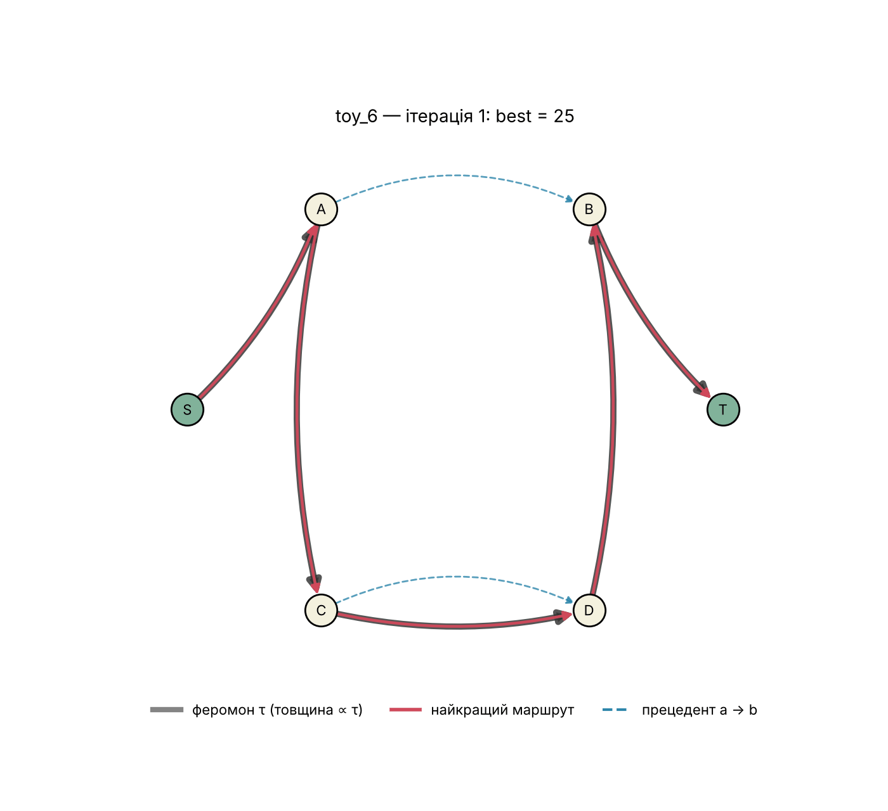

# ACO (Max–Min Ant System) для Sequential Ordering Problem

Лабораторна робота №1 з дисципліни «Моделі та алгоритми роєвого інтелекту».
**SOP:** знайти найдешевший маршрут через усі вершини орієнтованого графа від старту до фінішу,
у якому виконуються всі прецеденти «вершина a раніше за вершину b» (вартості несиметричні).
**Алгоритм:** Max–Min Ant System + локальний пошук or-opt з перевіркою прецедентів.



## Структура

```
data/                 задачі TSPLIB: br17.10, ESC11, ESC25, ry48p.1, ft53.1
src/
  sop_instance.py     задача SOP, читання TSPLIB, приклади 1 і 2 (toy_5, toy_6), повний перебір, точне DP, жадібний алгоритм
  mmas_sop.py         алгоритм MMAS
  local_search.py     локальний пошук or-opt
  run.py              запуск з командного рядка
  experiments.py      експерименти зі звіту -> results/tables/*.csv
  visualize.py        візуалізація: крок мурахи, карта феромону, GIF
  make_figures.py     рисунки для звіту 
notebooks/lab1_aco_sop.ipynb   демонстрація за структурою звіту
results/              tables/ (CSV), figures/ (PNG), gifs/ (анімації), console/ (вивід програми)
```

## Запуск

```bash
bash setup_venv.sh && source .venv/bin/activate

python -m src.run toy_6                 # один запуск з ходом ітерацій
python -m src.run ESC25 --runs 10       # 10 запусків MMAS і MMAS + or-opt (як у звіті)
python -m src.experiments all           # табл. 7 і табл. 8 звіту (~10 хв)
python -m src.make_figures all          # рисунки 1–9 і GIF
jupyter notebook notebooks/lab1_aco_sop.ipynb
```

## Результати (10 запусків; gap — середнє відхилення від оптимуму, %; у дужках — скільки запусків знайшли оптимум)

| Задача | n | Оптимум | Жадібний | MMAS | MMAS + or-opt |
|---|---|---|---|---|---|
| toy_5 (приклад 1) | 5 | 12 | 0.00 | 0.00 (10/10) | 0.00 (10/10) |
| toy_6 (приклад 2) | 6 | 22 | 22.73 | 0.00 (10/10) | 0.00 (10/10) |
| br17.10 | 18 | 55 | 43.64 | 0.00 (10/10) | 0.00 (10/10) |
| ESC11 | 13 | 2075 | 53.01 | 2.60 (0/10) | 0.00 (10/10) |
| ESC25 | 27 | 1681 | 99.88 | 3.18 (0/10) | 0.02 (9/10) |
| ry48p.1 | 49 | 15805 | 42.32 | 8.95 (0/10) | 0.02 (9/10) |
| ft53.1 | 54 | 7531 | 38.15 | 9.00 (0/10) | 2.01 (0/10) |

Обрані параметри: α = 1, β = 2, ρ = 0.05, p_best = 0.05, m = 25, феромон по черзі додають найкраща мураха ітерації та найкраща за весь час.

Дані: TSPLIB, розділ «Sequential ordering problem» (http://comopt.ifi.uni-heidelberg.de/software/TSPLIB95/).
